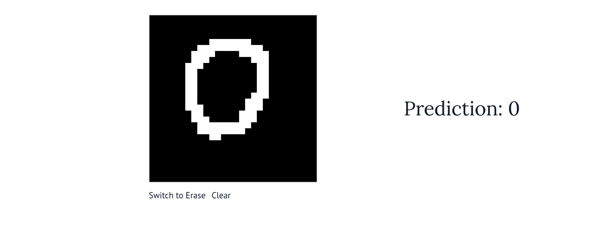
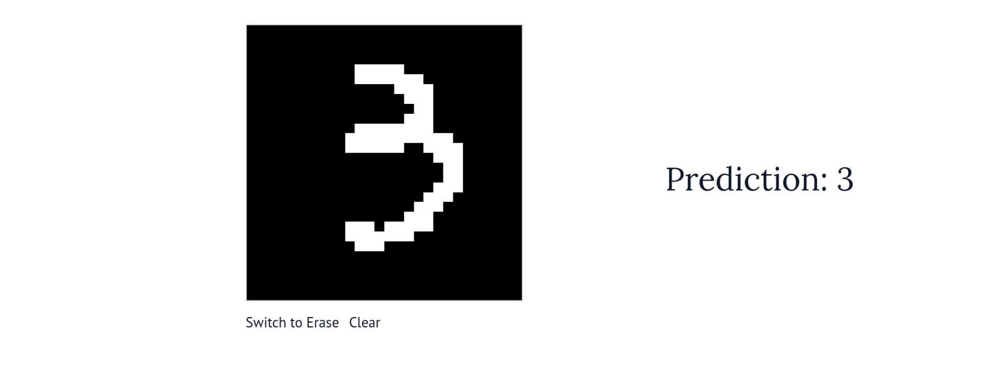

# MNIST Digit Classifier

An interactive neural network demo that recognizes handwritten digits (0-9) using JAX and Marimo.

## Overview

This project trains a simple 2-layer neural network on the MNIST dataset and provides an interactive web interface where you can draw digits and see real-time predictions from the trained model.

### Demo

<p align="center">
  
  
</p>

Draw digits on the canvas and watch the neural network classify them in real-time!

## Features

- **Custom Neural Network**: Built from scratch using JAX (no high-level frameworks like TensorFlow/PyTorch)
- **Interactive Visualizer**: Draw digits with your mouse and watch the network classify them in real-time
- **Clean Architecture**: Modular code with separate training, model, and visualization components

## Project Structure

```
.
├── model.py         # Neural network architecture and weight management
├── train.py         # Training script
├── visualizer.py    # Interactive Marimo app for drawing and predictions
├── mnist.npz        # MNIST dataset (required for training)
└── weights.pkl      # Trained model weights (generated after training)
```

## Requirements

- Python 3.12+
- JAX and JAXlib
- Optax (JAX optimizer library)
- NumPy
- Marimo (interactive notebook framework)
- Jaxtyping (type annotations for JAX)

## Installation

1. Clone this repository or download the files

2. Install dependencies:
```bash
pip install jax jaxlib optax jaxtyping numpy marimo
```

3. Ensure you have the MNIST dataset (`mnist.npz`) in the project directory

## Usage

### Training the Model

If you don't have pre-trained weights or want to retrain:

```bash
python train.py
```

This will:
- Load the MNIST dataset
- Train a neural network for 100,000 steps
- Print accuracy every 1,000 steps
- Save the trained weights to `weights.pkl`

Training parameters (can be modified in `train.py`):
- Hidden layer size: 32 neurons
- Batch size: 256
- Training steps: 100,000
- Learning rate: 0.005 → 0.00001 (linear decay)

### Running the Interactive Demo

Once you have trained weights:

```bash
marimo run visualizer.py
```

Or to open in edit mode:

```bash
marimo edit visualizer.py
```

This will launch a web interface where you can:
- Draw digits on a 28×28 pixel canvas
- See the model's prediction update in real-time
- Toggle between draw and erase modes
- Clear the canvas to start over

## How It Works

### Network Architecture

```
Input Layer (784 pixels)
    ↓
Hidden Layer (32 neurons, ReLU activation)
    ↓
Output Layer (10 neurons, Softmax activation)
    ↓
Prediction (probabilities for digits 0-9)
```

### Training Process

1. **Data Preprocessing**: MNIST images (28×28 pixels) are flattened to 784-dimensional vectors and normalized to [0, 1]
2. **Forward Pass**: Input flows through the network to produce predictions
3. **Loss Calculation**: Mean squared error between predictions and one-hot encoded labels
4. **Backpropagation**: JAX automatically computes gradients via `jax.value_and_grad`
5. **Weight Update**: AdamW optimizer adjusts weights to minimize loss

### The Visualizer

The Marimo app creates a custom drawing widget using AnyWidget:
- 28×28 canvas that scales to 280×280 pixels for easier drawing
- Real-time conversion of canvas pixels to grayscale values
- Automatic inference when you draw or modify the canvas
- Displays the digit with highest predicted probability

## Technical Details

- **Framework**: JAX for automatic differentiation and JIT compilation
- **Optimizer**: AdamW with linear learning rate schedule
- **Loss Function**: Mean Squared Error (MSE)
- **Activation Functions**: ReLU (hidden layer), Softmax (output layer)
- **Initialization**: Uniform random initialization for all weights and biases

## Customization Ideas

- Experiment with different architectures (more layers, different sizes)
- Try different optimizers or learning rates
- Add data augmentation during training
- Display confidence scores for all 10 digits
- Save and compare multiple model checkpoints
- Add a confusion matrix to analyze common mistakes

## Learning Outcomes

This project demonstrates:
- Building neural networks from scratch using JAX
- Training with gradient descent and backpropagation
- Creating interactive ML demos with Marimo
- Understanding the full ML pipeline: data → training → inference → visualization

## License

Free to use for educational purposes.

## Acknowledgments

- MNIST dataset: Yann LeCun, Corinna Cortes, and Christopher J.C. Burges
- Built as a learning project for understanding neural networks
